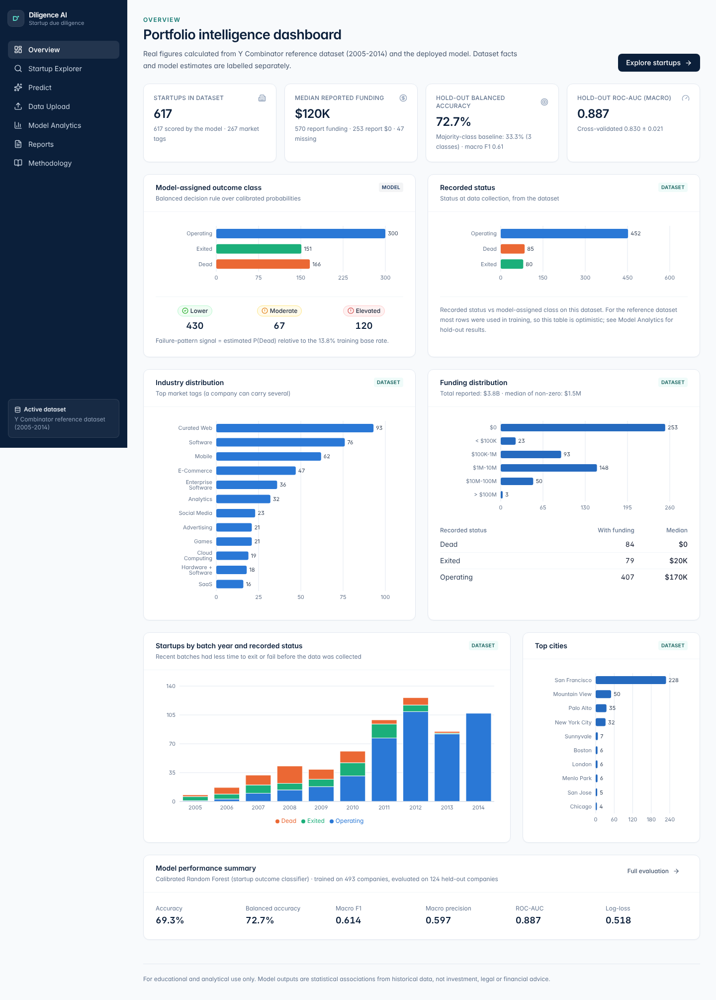
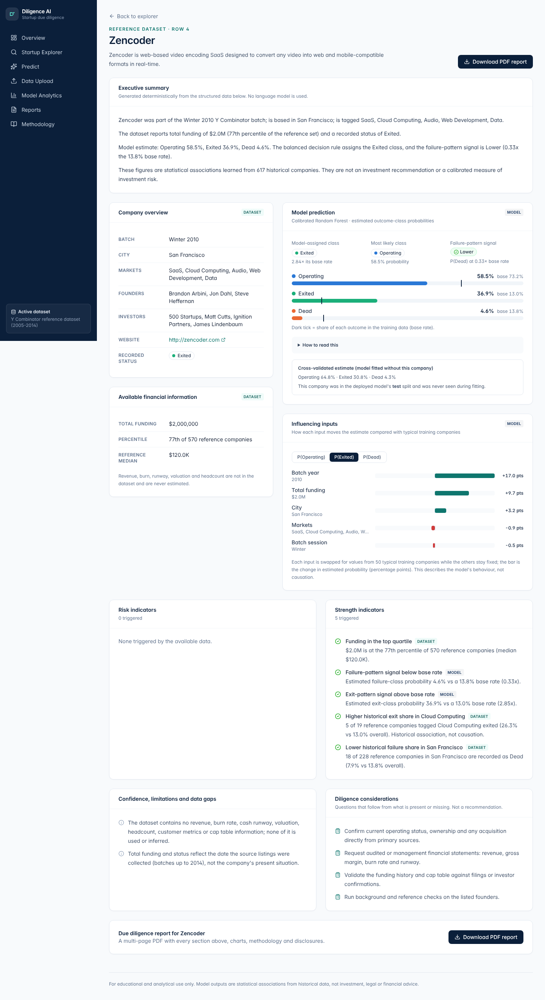
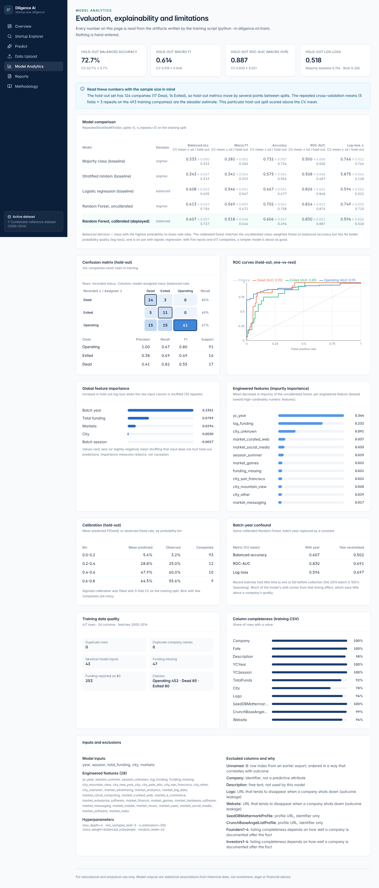
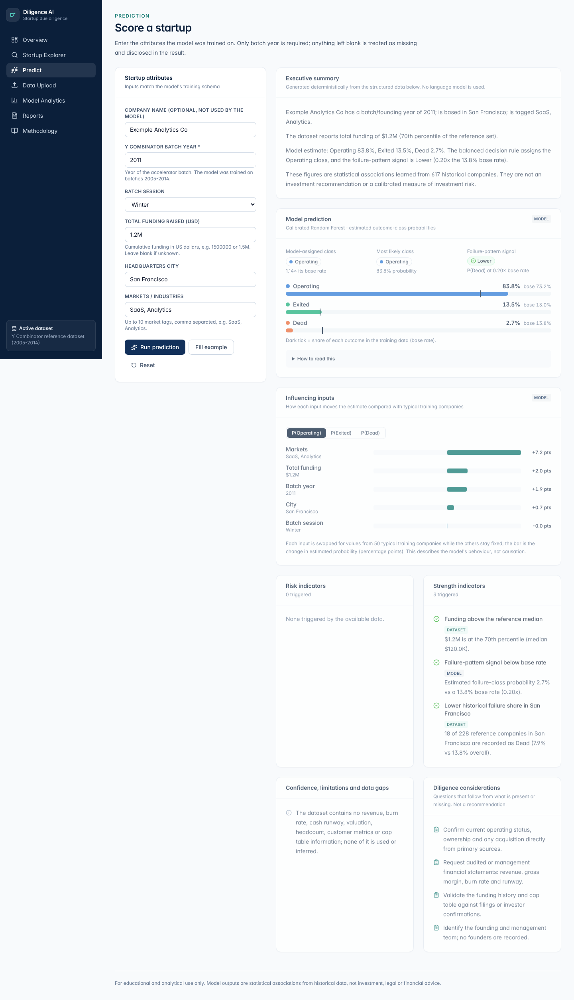
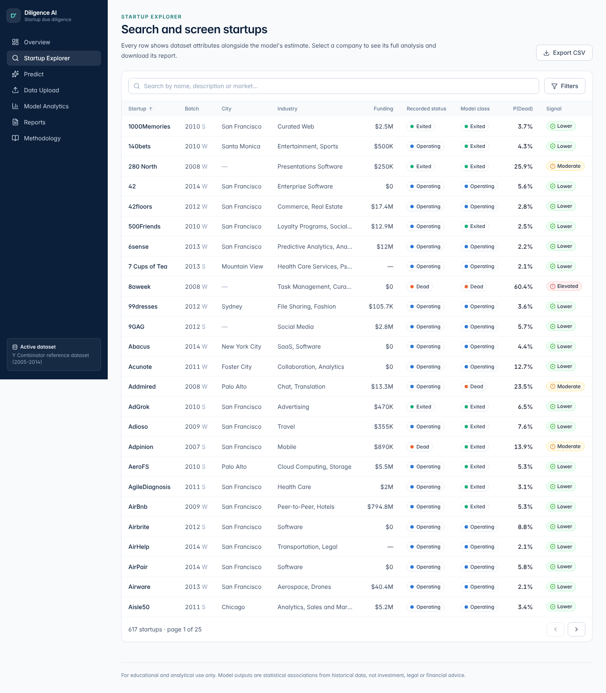

# AI Startup Due Diligence Platform

A full-stack machine-learning application for screening startups. It covers:

- exploring 617 historical Y Combinator companies;
- scoring any startup with a calibrated Random Forest;
- seeing which inputs drive each estimate;
- uploading your own CSV portfolio;
- downloading a company-specific PDF due-diligence report.

> **Live demo:** _added after deployment verification (see [Deployment](#deployment))_
>
> Educational and analytical project. It is not investment advice and not a regulated advisory service.



## Features

- **Overview dashboard.** Real figures from the active dataset:
  - totals and the model-assigned class distribution;
  - recorded status, industries, funding buckets, batch-year × status and top cities;
  - a model performance summary.
- **Startup Explorer.** Search, eight filters, sortable columns, pagination and CSV export. Filters live
  in the URL, so they survive a refresh and can be shared.
- **Startup detail.**
  - Dataset facts (profile, available funding) shown separately from the model estimate.
  - Calibrated probabilities against base rates, plus the cross-validated estimate.
  - Per-input contributions, risk and strength indicators tagged with their source.
  - Limitations, diligence questions and a PDF download.
- **Prediction.** A form generated from the model's own schema, with client- and server-side
  validation. Missing inputs are imputed and disclosed.
- **Data upload.**
  - Drag-and-drop CSV, then a validation report: column mapping, missing-column warnings and
    row-level issues.
  - A scored preview, then one click to make the upload the active dataset for every page.
- **Model analytics.** Comparison with baselines, confusion matrix, ROC curves, calibration table,
  permutation and impurity importance, year-confound sensitivity, data quality and excluded columns.
- **Reports.** Pick any company and preview or download its own multi-page PDF.
- **Methodology.** Purpose, data provenance, ML method, evaluation, architecture, limitations and intended use.

| Startup detail | Model analytics |
|---|---|
|  |  |
| **Prediction** | **Explorer** |
|  |  |

## Technology

| Layer | Stack |
|---|---|
| Frontend | React 19, React Router 7, Vite 8, Tailwind CSS 4, Recharts, Axios, lucide-react |
| Backend | Python 3.13, Flask 3.1, Gunicorn, pandas, NumPy |
| ML | scikit-learn 1.9 (custom transformer, Random Forest, sigmoid calibration, permutation importance), joblib |
| Reports | ReportLab, Matplotlib (DejaVu Sans for Unicode names) |
| Tests | pytest, Vitest + Testing Library, Playwright |
| Deploy | Docker multi-stage image, one Render web service (free plan), GitHub Actions CI |

## Architecture

```text
React SPA ──(same-origin /api)──> Flask + Gunicorn ──> scikit-learn pipeline (model/pipeline.joblib)
                                     │                 reference data (data/CleanStartups.csv)
                                     ├─ in-memory upload store (TTL 2 h, never written to disk)
                                     └─ ReportLab/Matplotlib PDF built per request
```

The Flask service also serves the built frontend, with an `index.html` fallback so client routes work
on refresh. Details are in [docs/ARCHITECTURE.md](docs/ARCHITECTURE.md), and the full endpoint
reference is in [docs/API.md](docs/API.md).

```text
app.py                     WSGI entry (gunicorn app:app)
diligence/                 backend package
  api.py  errors.py  config.py  analytics.py  insights.py
  data/  ingest.py store.py query.py
  ml/    schema.py features.py train.py model.py
  reports/ pdf.py charts.py
model/                     trained pipeline, metadata, metrics, importance, evaluation splits
data/CleanStartups.csv     reference dataset
frontend/                  React app (src/pages, src/components, src/lib, e2e/)
tests/                     pytest suite
docs/                      architecture, API, model evaluation, deployment, testing, screenshots
Dockerfile  render.yaml  .github/workflows/ci.yml
```

## Running locally

Requirements: Python 3.13 and Node.js 22.

```bash
# Backend
python -m venv .venv
.venv/bin/pip install -r requirements-dev.txt       # Windows: .venv\Scripts\pip ...
APP_ENV=development .venv/bin/python app.py         # http://127.0.0.1:5000

# Frontend (second terminal); Vite proxies /api to :5000
cd frontend
npm ci
npm run dev                                          # http://localhost:5173
```

Production-like run, with one process serving everything:

```bash
cd frontend && npm run build && cd ..
.venv/bin/gunicorn app:app --bind 127.0.0.1:8000 --workers 1 --threads 4   # http://127.0.0.1:8000
```

Or with Docker: `docker build -t diligence . && docker run -p 10000:10000 diligence`.

To retrain the model, which reproduces the committed artifacts: `.venv/bin/python -m diligence.ml.train`.

## Dataset

`data/CleanStartups.csv` holds 617 Y Combinator companies from batches 2005–2014, with fields from
public SeedDB/CrunchBase listings. The recorded `Fate` is Operating (452), Exited (80, acquired or
IPO) or Dead (85). The collection date is not documented; since the latest batch is 2014, statuses
and funding reflect roughly 2014–2015.

## Machine-learning method

- **Inputs.** Batch year, session, total funding (log-scaled, with a missing flag), city, and market tags.
  - Rare cities and tags (fewer than 10 companies) are grouped.
  - Unseen values at prediction time map to "other".
  - All of this happens inside a custom scikit-learn transformer saved with the model, so training
    and serving cannot drift.
- **Removed leakage.** The previous model trained on the row index, company name, logo and website
  URLs, and label-encoded free text. These are now excluded, along with founder and investor
  listings, whose completeness tracks the outcome.
- **Model.** A class-weighted Random Forest (300 trees, depth 6, min leaf 3) tuned by 5-fold CV on
  a stratified 80% split, then wrapped in sigmoid calibration.
- **Output.** Calibrated probabilities for Operating, Exited and Dead, plus:
  - a **model-assigned class**: the outcome whose probability most exceeds its base rate (balanced decision rule);
  - a **failure-pattern signal**: P(Dead) relative to its 13.8% base rate.

  Because the target is a recorded status rather than a return, it is never presented as a
  calibrated investment-risk score.
- **Explanations.** Permutation importance shows global reliance on each input. Per-company
  attributions swap each input for values from 50 typical training companies. Neither implies causation.

## Model evaluation

The deployed model, scored on a 124-company hold-out set and with repeated 5×3 stratified CV on the
training split. Full tables are in [docs/MODEL_EVALUATION.md](docs/MODEL_EVALUATION.md).

| Model | Balanced accuracy (CV / hold-out) | Macro F1 (CV / hold-out) | ROC-AUC macro (CV / hold-out) | Log-loss (CV / hold-out) |
|---|---|---|---|---|
| Majority class | 0.333 / 0.333 | 0.282 / 0.282 | 0.500 / 0.500 | 0.766 / 0.764 |
| Logistic regression | 0.608 / 0.605 | 0.546 / 0.547 | 0.826 / 0.868 | 0.594 / 0.522 |
| Random Forest, uncalibrated | 0.613 / 0.756 | 0.569 / 0.671 | 0.824 / 0.876 | 0.749 / 0.715 |
| **Random Forest, calibrated (deployed)** | **0.607 / 0.727** | **0.518 / 0.614** | **0.830 / 0.887** | **0.596 / 0.518** |

What these results show:

- The model clearly beats naive baselines. Calibration keeps the forest's balanced accuracy while
  markedly improving probability quality.
- Logistic regression performs about as well.
- Batch year dominates: neutralising it drops CV ROC-AUC from 0.83 to 0.69. Recent batches simply
  had less time to exit or fail.
- Hold-out recall: Dead 0.82, Exited 0.69, Operating 0.67. About 31% of hold-out companies are
  assigned the wrong class.

## PDF reports

`GET /api/startups/{id}/report.pdf` builds an A4 report in memory for exactly the selected record.
It works for reference and uploaded datasets alike, and the file is named after the company. Sections:

1. Cover page and generation date
2. Executive summary
3. Company profile
4. Available financial information
5. Funding analysis, with a histogram against the reference set
6. Model prediction, with a probability chart against base rates and the cross-validated estimate
7. Confidence and limitations
8. Risk indicators
9. Strength indicators
10. Feature contributions, with charts and a table
11. Investment-related considerations
12. Data-quality disclosures
13. Methodology
14. Disclaimer

The narrative text is assembled deterministically from structured values. No LLM is used, and no
financial figure is invented: absent data is reported as absent.

## Testing

```bash
.venv/bin/python -m pytest                        # 50 backend tests
cd frontend && npm run lint && npm test           # ESLint + 15 Vitest tests
npm run build && npx playwright test              # 11 end-to-end tests against Gunicorn + built SPA
```

The test inventory is in [docs/TESTING.md](docs/TESTING.md). CI runs all of it on every push. The engineering log is in [docs/PROGRESS.md](docs/PROGRESS.md).

## Deployment

The app is deployed as a single Docker web service on Render's free plan, defined in
[`render.yaml`](render.yaml) and [`Dockerfile`](Dockerfile). Health check: `/api/health`.
Configuration and free-tier behaviour are covered in [docs/DEPLOYMENT.md](docs/DEPLOYMENT.md).

## Limitations and future work

- **Data.** 617 companies from one accelerator and era. Funding is cumulative at collection time
  (look-ahead). There is no revenue, burn, valuation, team or traction data.
- **Model.** Much of its skill comes from the batch-year timing effect. Probabilities are calibrated
  on a small sample.
- **Uploads.** These live in memory and disappear when the free instance sleeps. There are no user
  accounts, so privacy rests on an unguessable dataset id.
- **Future work:**
  - a richer, more recent dataset with financial and team features, and a survival-style target
    (time to exit or failure) instead of a status snapshot;
  - authentication with persistent PostgreSQL storage for user portfolios;
  - SHAP values once a single-model explainer fits the calibrated ensemble;
  - rate limiting, and a background job queue for PDF generation.

## License

Educational and portfolio use. Add a license file before any production distribution.
